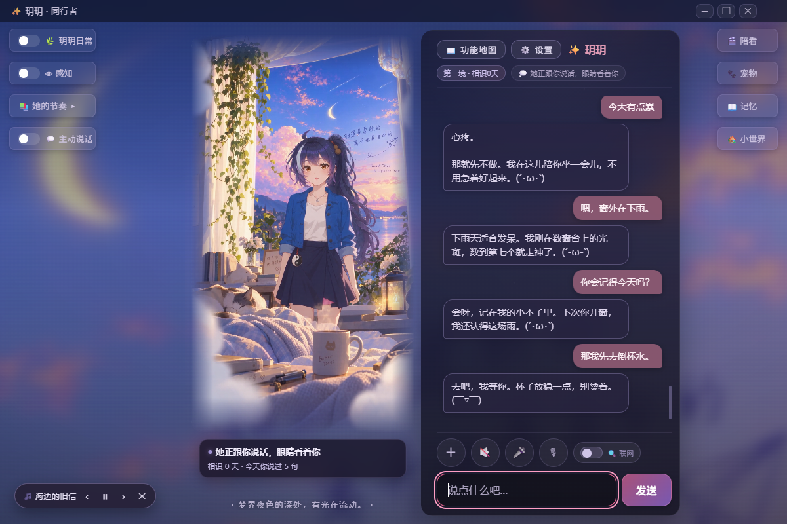
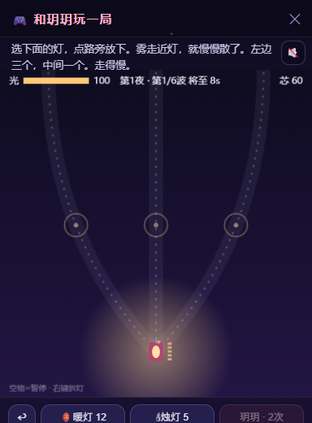
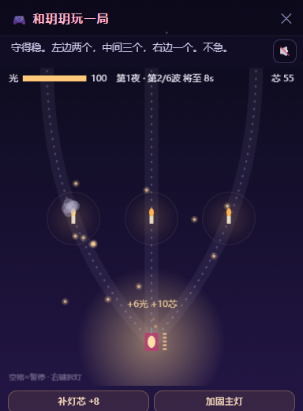

  

<h1 align="center">玥玥 · Yueyue Companion — 官方下载</h1>

  
  
  

  <b>不催你变好，不替你总结，只是在你旁边坐着。</b> 
  A local-first Windows desktop AI companion — the pavilion philosophy.

  <a href="https://magnificent-gaufre-629323.netlify.app/"><b>宣传页（实机图/规格/路线图）</b></a> ·
  <a href="https://magnificent-gaufre-629323.netlify.app/support.html"><b>打赏页</b></a> ·
  <a href="https://github.com/zhumo-jiabing/yueyue-companion-yueyuetongxingzhe"><b>开源外围引擎（AGPL-3.0）</b></a> ·
  QQ 群 <b>1002686604</b>（404号玥玥小窝）

---

## ⬇ 直接下载（Windows 64 位）

**主程序安装包：** [Yueyue-Setup-0.3.0-beta.10.exe](https://github.com/zhumo-jiabing/yueyue-download/releases/latest/download/Yueyue-Setup-0.3.0-beta.10.exe)  
**大小：** 248,751,237 B  
**SHA-256：** `14ABE613A3F82E153DA65DA441B6CE042CD2A6F9EF55E710BE1819AC64BBBA69`  
**安装说明：** [INSTALL-beta10.txt](https://github.com/zhumo-jiabing/yueyue-download/releases/latest/download/INSTALL-beta10.txt)

三步安装：①双击安装包；②SmartScreen 选「更多信息 → 仍要运行」（未签名）；③打开「玥玥」，第一次跟着五步走。

## 软件介绍

玥玥是一个**住在 Windows 电脑里的 AI 同行者**：双脑对话（思考脑定调、说话嘴流式）、本地记忆（IndexedDB 白盒分层）、本地 TTS 语音、透明 Q版桌宠与立绘视频情绪层，外加一个不惩罚失败的小游戏「守夜」。
对话与记忆**默认存在本机**；发消息时本轮对话与少量记忆会发送给你自己配置的模型服务商，整库不上传；她不是伴侣、不是心理治疗师、不是情感垃圾桶，也不假装真人。

| 能力 | 一句话 |
|---|---|
| 双脑对话 | 思考脑定调、说话嘴流式；反傲慢铁律：不分析你、不替你总结、不说「会好的」 |
| 本地记忆 | 她记得你们说过什么；排序与注入上限白盒可查，整库永不出本机 |
| 本地语音 | Qwen3-TTS / GPT-SoVITS / IndexTTS / Kokoro 多引擎，语音包另装 |
| 会动的她 | 透明 Q版桌宠 + 立绘视频情绪层，会看你会眨眼 |
| 守夜 · 塔防 | 摆灯守主灯；灭就灭了，她还在这儿；没有排行榜/抽卡/「再来一次」 |
| 凉亭哲学 | 允许无聊、允许沉默、允许不说；存在本身就是最大的意义 |

  

  
  

更多实机截图（记忆窗 / 桌宠 / 守夜结算）见[宣传页](https://magnificent-gaufre-629323.netlify.app/)。

完整隐私政策与用户协议在应用内首次启动展示。

## 下载（Windows · 0.3.0-beta.10）

| 件 | 链接 | 校验 |
|---|---|---|
| 主程序安装包 | [Yueyue-Setup-0.3.0-beta.10.exe](https://github.com/zhumo-jiabing/yueyue-download/releases/download/v0.3.0-beta.10/Yueyue-Setup-0.3.0-beta.10.exe) | 248,751,237 B · sha256 前16 `14ABE613A3F82E15` |
| 发布页 / 更新日志 | [v0.3.0-beta.10](https://github.com/zhumo-jiabing/yueyue-download/releases/tag/v0.3.0-beta.10) | 公开直链，无需登录 |
| 语音包（让她出声） | QQ 群文件 / 网盘（见群公告） | GPU 1.7B 约 6 GB；超 GitHub 单附件 2 GB 上限故不挂 GitHub |

- 主程序**默认不含语音**：装完会打字、不出声；装语音包后设置里「语音朗读」自己亮。
- 安装包**未签名**：SmartScreen 提示时选「仍要运行」。
- 卸载只删程序目录，**不动你的记忆与设置**（%APPDATA% 数据零触碰）。

> 体验版 · 本地单机桌面工具 · 法律评估中。语音与立绘含 AI 生成内容。不满 18 岁不适用。
> 本软件没有自动联系第三方的功能；受技术条件与隐私限制，无法替你联系任何人。紧急帮助请拨打 12356 / 120 / 110。

## 0.3.0-beta.10 更新了什么

- **下载入口前置**：本页顶部直接给安装包；Release 设为 latest。
- **隐私与红线文案重写**：数据只在本地、由你自己管控；联系方式只留 QQ 群；红线改为「技术条件与隐私限制，无法替你联系任何人」。
- **灵魂文件加构建水印与初级混淆**：挡住随手复制/改包；这不是安全加密，密钥在客户端。
- **透明 Q 版桌宠 / 游戏自动收起 / 夜间青金**：沿用 beta.9，继续修白边、拖动与展开。
- **版本号**：`0.3.0-beta.10`。

**已知问题**：Q 图仍有原图白色描边/靴下白点；无真眨眼/口型；只识别 17 款具名游戏；安装包未签名；灵魂文件是混淆不是安全。

## 反馈

QQ 群 **1002686604**（404号玥玥小窝）· [宣传页](https://magnificent-gaufre-629323.netlify.app/) · [打赏页](https://magnificent-gaufre-629323.netlify.app/support.html)（打赏不解锁任何功能）。
外围引擎开源（AGPL-3.0）见[开源仓库](https://github.com/zhumo-jiabing/yueyue-companion-yueyuetongxingzhe)；核心人格 / 双脑 / 记忆 / 合规文案闭源专有。更新日志见 [CHANGELOG.md](CHANGELOG.md)。

纸的颜色，不用屏幕的颜色。 · 存在本身就是最大的意义。

